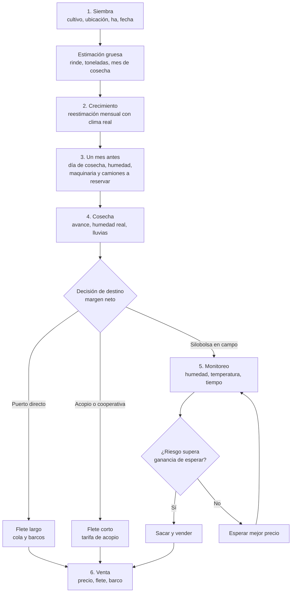

# Logística de cosecha y post-cosecha: asistente de decisión

Desafío 02 del Hackatón Donweb Day. Este documento vive fuera de `~/proyecto` a propósito: ese directorio queda vacío hasta las 15:15 del evento.

## Problema

Un productor siembra un cultivo y necesita decidir, con la información disponible en cada momento:

1. Cuándo se va a poder cosechar.
2. Cuándo y cuántos camiones pedir, y de qué tipo.
3. Adónde va el grano: puerto directo, silobolsa o silo profesional.
4. Si ya está embolsado, cuándo conviene sacarlo y venderlo antes de que se deteriore.

El objetivo a optimizar es el **margen neto** y la **toma de decisiones**. Cubre los ejes A (silobolsas), B (tiempos muertos) y D (combustible/flete) del desafío.

## Criterios de evaluación y qué los cubre

| Criterio | Peso | Qué lo cubre |
|---|---|---|
| Resolución del problema | 35% | Comparador de destinos con margen neto y recomendación |
| Profundidad y completitud | 30% | Ventana de cosecha, camiones, riesgo de silobolsa, etapas |
| Calidad de la IA integrada | 25% | OpenAI explica la recomendación y responde escenarios |
| Presentación | 10% | Guion de demo de 2 minutos y README mínimo |

Sin URL pública funcionando no hay evaluación. Desplegar primero algo simple.

## Entradas del usuario

- Cultivo (soja, maíz, trigo).
- Ubicación del campo (punto en el mapa o coordenadas): define distancias, clima y rinde.
- Hectáreas. El rinde esperado lo estima el sistema, no el usuario.
- Fecha de siembra y fecha límite deseada para terminar la cosecha (tiempo disponible).
- Maquinaria propia disponible, si la hay (cosechadoras, tractores, tolvas, camiones, embolsadora). Lo que falte se alquila o se contrata.
- Precios editables: cada máquina o servicio, silobolsa, silo/acopio, flete, grano.
- Llegada de barcos al puerto: manual al inicio. Más adelante, predicción (ver módulo 5).
- Humedad del grano (manual o estimada).

Unidades: cálculo interno en toneladas y USD. El rinde se muestra en qq/ha (1 qq = 100 kg). ARS como conversión opcional.

## Módulos

### 1. Ventana de cosecha

- Rinde esperado: promedio de los últimos 5 años por departamento (series de [datos.gob.ar](https://datos.gob.ar/dataset?tags=agricultura)), corregido por la lluvia del año. No existe un mapa de rendimiento potencial descargable por departamento.
- Madurez: ciclo en días editable por cultivo y variedad. No se encontró una fuente para grados-día hasta R8.
- Salida: rango (inicio, óptimo, fin). La granularidad depende de la distancia a la cosecha: meses lejos, semanas a ~2 meses, días a ~1 mes.
- Reglas de INTA Manfredi:
  - Base de recibo 13,5% de humedad.
  - Cosechar con 15% reduce a la mitad las pérdidas por desgrane.
  - Soja a 13,5% con más de 10 días de lluvia pierde más que empezar a 15%.
  - ~70% de las pérdidas ocurren en la plataforma.
  - Demorar 33 días subió la pérdida de 56 a 264 kg/ha en un ensayo.
  - Con lluvias fuertes las aceiteras suben la tolerancia de recibo, con descuentos.

### 2. Maquinaria, tiempo y flete

"Cadetes" = toda la maquinaria de cosecha, transporte y armado de silobolsas: cosechadoras, tractores, tolvas/acoplados, camiones y embolsadoras.

**Dimensionado por tiempo disponible**
- Toneladas = hectáreas × rinde estimado.
- Días disponibles = fecha límite − inicio de la ventana de cosecha, menos días de lluvia esperados (IMERG).
- Cosechadoras = ceil(hectáreas ÷ (ha/día por cosechadora × días disponibles)). Menos tiempo, más cosechadoras. La capacidad ha/día es un parámetro editable.
- Tractores y tolvas: uno por cosechadora o según el esquema de descarga (parámetro).
- Embolsadora: si el destino es silobolsa, t/hora de embolsado × horas disponibles.

**Camiones: dos modalidades a comparar**
- A. Camiones que se quedan en el campo toda la cosecha (contrato por día): costo = camiones × días × tarifa diaria, con tiempo ocioso incluido.
- B. Viajes de ida y vuelta (pago por viaje o por t/km): ciclo = 2 × distancia ÷ velocidad + carga + descarga + cola. Viajes por camión y día = horas útiles ÷ ciclo. Camiones = toneladas por día ÷ (capacidad ~30 t × viajes por día).
- Gana la modalidad de menor costo total. A favor de A: distancias cortas. A favor de B: distancias largas.
- Se piden con N días de anticipo, ajustado por cola de descarga y lluvia.

**Costo de transporte por ubicación**
- Distancia por ruta (no en línea recta) desde el campo a cada destino posible. Geocodificación y ruteo con datos de OpenStreetMap (Nominatim y OSRM).
- Flete = toneladas × distancia × tarifa por t/km. Referencia CATAC (mensual, última publicada abril 2026). Orden de magnitud ~0,094 US$/t/km, sin fecha confirmada. El flete llega a ~30% del valor del grano en distancias largas.
- El mismo cálculo corre para cada destino. El destino lejano paga más flete pero puede vender mejor.

### 3. Decisión de destino

```
margen(opción) = t × precio(fecha) − flete − almacenaje − secado
                 − merma esperada − costo financiero − costo de demora/cola
```

Se evalúa para las 3 opciones y varias fechas de venta. Gana el máximo.

Destinos candidatos, cada uno con su ubicación y su distancia por ruta:

- **Silobolsa en el campo:** sin flete inicial. Costo de bolsa, embolsado y extracción, y riesgo de pérdida según humedad, temperatura y tiempo. El flete se paga después, cuando se saca para vender.
- **Concesionaria, cooperativa o acopio (silo profesional):** puede estar cerca o lejos. Hay que elegir entre varios. Tarifa de acopio, secado y merma por manipuleo. Da flexibilidad y cobra más. Si el silo cobra mucho, el modelo recomienda dejar el grano el menor tiempo posible.
- **Puerto directo:** cobra ya, paga el flete más largo y puede esperar en cola. Se contrasta con la disponibilidad de barcos (módulo 5).

Ubicaciones de acopios y cooperativas: pendiente de buscar una fuente. Si no hay un listado abierto utilizable, se carga una lista curada de la zona de demo.
- Guardar conviene solo si el spread de precio supera el costo de guardar.

### 4. Monitoreo de silobolsa

Tabla de plazo seguro de INTA por humedad al embolsar:

| Humedad al embolsar | Riesgo bajo | Riesgo medio | Riesgo alto |
|---|---|---|---|
| Hasta 14% | 6 meses | 12 meses | 18 meses |
| 14 a 16% | 2 meses | 6 meses | 12 meses |
| Más de 16% | 1 mes | 2 meses | 3 meses |

- Sobre 20 °C el riesgo sube. En invierno el grano húmedo se comporta mejor.
- También influyen la hermeticidad y las roturas.
- Salida: aviso de "conviene sacar y vender ya" cuando el costo esperado del deterioro supera la ganancia de esperar.
- Fuentes de 2015 a 2016: usar como reglas de riesgo, no como norma vigente.

### 5. Predicción de barcos en el puerto (fase posterior)

- Objetivo: estimar cuándo habrá barcos disponibles para cargar y contrastarlo con la fecha en que el grano puede llegar al puerto.
- Si el grano llega antes de que haya barco, hay cola y costo de espera, o conviene guardarlo.
- Entrada inicial: calendario de arribos manual o simulado. El método de predicción se define más adelante.
- Afecta el costo de demora del destino "puerto directo" y la fecha óptima de venta. El nivel del Paraná (SWOT) puede incidir en el calado y el flete fluvial.

### Decisión de venta en el último mes: enviar a vender o esperar

Además de la fecha de arribo de los barcos, se considera:

- **Precio:** disponible hoy contra futuro de cosecha (spread). Guardar conviene solo si el spread supera el costo de guardar. Tipo de cambio y retenciones como escenario editable. Bonificaciones y rebajas por calidad y humedad. Fuente no verificada: pizarra BCR o Matba-Rofex, carga manual al inicio.
- **Barcos y puerto:** fecha de arribo y ventana de carga, cola de camiones y turno de descarga, costo de espera si el grano llega antes que el barco, riesgo de perder el barco si llega tarde, nivel del Paraná (calado y flete), paros como escenario de riesgo.
- **Costos de esperar:** silobolsa (bolsa, embolsado, extracción, merma por riesgo), costo financiero (tasa, necesidad de caja, vencimientos), flete en pico contra un mes después.
- **Restricciones:** cupo del silo o acopio, disponibilidad de camiones y maquinaria, lluvia que retrasa cosecha y llegada.

```
vender_ahora    = t × precio_hoy − flete_hoy
esperar_a(t_i)  = t × (1 − merma_i) × E[precio_i] − flete_i − costo_guardar_i − interés_i
decisión        = argmax entre vender_ahora y cada esperar_a(t_i)
```

La salida incluye el **spread mínimo de equilibrio**: cuánto tiene que subir el precio para compensar guardar. La IA lo explica en lenguaje de productor.

### 6. IA (OpenAI)

- No hace los cálculos: eso lo hace código determinista y auditable.
- Explica la recomendación en lenguaje de productor, justifica el trade-off y responde escenarios ("¿y si llueve 10 días más?").
- Implementar reintentos y manejo de límites: la API key es compartida.

## Flujo: de la siembra a la venta



### Qué se estima y con qué datos en cada etapa

| Etapa | Qué se estima | Datos que necesita |
|---|---|---|
| 1. Siembra | Rinde (rango amplio), toneladas, mes de cosecha, maquinaria preliminar | Rinde histórico por departamento (datos.gob.ar), clima histórico (NASA POWER), ciclo del cultivo (editable) |
| 2. Crecimiento | Se acota la fecha y el rinde según cómo viene el año | Lluvia acumulada (IMERG), temperatura (POWER) |
| 3. Un mes antes | Día de cosecha, humedad del grano esperada, cosechadoras y camiones a reservar, modalidad de camión | Pronóstico de lluvia, ha/día por máquina, distancia por ruta (OpenStreetMap), tarifas |
| 4. Cosecha | Avance diario, pérdida por demora, destino de cada tanda de toneladas | Humedad medida, lluvias, precio del grano, flete, acopios cercanos, fecha de barcos |
| 5. Silobolsa | Riesgo de deterioro y fecha límite de venta | Humedad al embolsar, temperatura y humedad ambiente (POWER), meses guardado, hermeticidad |
| 6. Venta | Mejor fecha y destino, margen neto final | Precio del día y a futuro, flete, cola y arribo de barcos, costo de guardar, costo financiero |

### De dónde sale cada dato

| Tipo | Datos | Cómo entra |
|---|---|---|
| Automático, abierto | Temperatura y humedad (NASA POWER), lluvia (IMERG), nivel del Paraná (SWOT), rinde histórico (datos.gob.ar), rutas y distancias (OpenStreetMap) | Se consulta por API o se precarga |
| Manual del usuario | Cultivo, ubicación, ha, fecha de siembra, fecha límite, maquinaria propia, humedad medida | Formulario |
| Supuesto editable | Precios de maquinaria, flete, silobolsa, acopio, grano, ha/día por máquina, capacidad del camión | Valores de referencia precargados, el usuario los cambia |
| Sin fuente abierta | Arribo de barcos y cola de puerto, ubicación de acopios y cooperativas | Manual o simulado al inicio |

## Datos y fuentes

| Dato | Fuente | Estado |
|---|---|---|
| Temperatura y humedad | NASA POWER | API abierta |
| Precipitación | GPM IMERG | Dato abierto |
| Nivel del Paraná | SWOT (NASA/CNES) | Dato abierto, uso opcional |
| Rinde histórico | datos.gob.ar | Series observadas |
| Flete | CATAC (referencia mensual) | Verificar fecha |
| Cosecha por servicio | FACMA, ~US$ 90/ha con soja a 24 qq/ha | Campaña no indicada |
| Gasoil | 18 a 25% del costo de cosechadora en maíz | Referencia |
| Silobolsa, tractor, tolva, silo profesional | Sin dato 2026 | El usuario carga |
| Llegada de barcos y cola de puerto | Sin fuente abierta fiable | Manual o simulado |

Precios y tarifas son supuestos editables con valores de referencia. Decirlo en la demo.

## Orden de entrega

1. Formulario del lote y tabla comparativa de destinos con margen neto, desplegado con URL pública.
2. Ventana de cosecha con clima real (NASA POWER, IMERG).
3. Camiones y flete.
4. Monitoreo y riesgo de silobolsa.
5. Explicación con IA y escenarios.
6. README mínimo (problema, cómo corre, URL, decisiones) y guion de demo de 2 minutos.

## Reglas del evento

- No crear ni commitear código del proyecto antes de las 15:15. `~/proyecto` sin `git init` hasta entonces.
- Trabajo individual, sin ayuda de terceros.
- Entrega a las 18:30: URL pública en el Cloud Server provisto y enlace al repositorio de GitHub.
- La key de OpenAI es solo para la IA del producto. Las keys van en `~/.env`, nunca en el proyecto.
- Fijar la versión de Node en `package.json` según la del Cloud Server.

## Pendientes

- Fuente de ubicaciones de acopios, cooperativas y concesionarias.
- Método de predicción de barcos en el puerto.
- Capacidad ha/día por cosechadora y capacidad de la embolsadora.
- Conseguir tarifas vigentes: CATAC, FACMA, embolsado, silo profesional, alquiler de maquinaria.
- Definir el ciclo en días por cultivo.
