# AgroFlow · Cosecha y despacho sin colas

**Planificá la cosecha y el despacho para no quedar en la cola del pico.** Un simulador que le dice al productor cuándo cosechar, adónde mandar el grano y cuándo vender, conectado a un marketplace de cadetes (contratistas, transportistas y embolsadoras) que ejecuta el plan. Cada reserva del marketplace suma un dato propio: cuántos camiones van a ir a qué puerto y qué día, antes de que salgan.

Desafío 02 del Hackatón Nasa Space Apps. Posicionamiento y diferencial en [docs/FRENTE.md](docs/FRENTE.md); plan técnico original en [PROYECTO.md](PROYECTO.md).

**URL pública:** https://agroflow-mctx.onrender.com

<p align="center">
  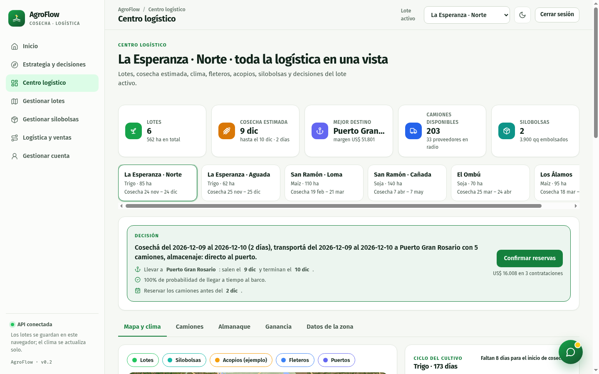
</p>

**Enlaces:** [App web (Vercel)](https://marcianos-hazel.vercel.app) · [Informe de entrega NASA Space Apps](docs/INFORME_NASA_SPACE_APPS.md) · Presentación: [Español](docs/presentaciones/AgroFlow-presentacion.pptx) · [English](docs/presentaciones/AgroFlow-presentation-en.pptx)

---

## Capturas

Capturas de la app (entrando como visitante, con lotes y silobolsas de ejemplo).

| | |
| --- | --- |
| **Resumen** · estado de los lotes y la campaña<br>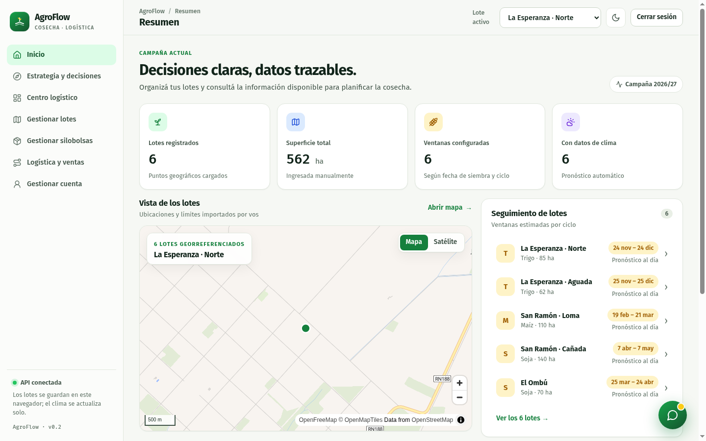 | **Estrategias** · comparación de estrategias de cosecha, destino y venta<br>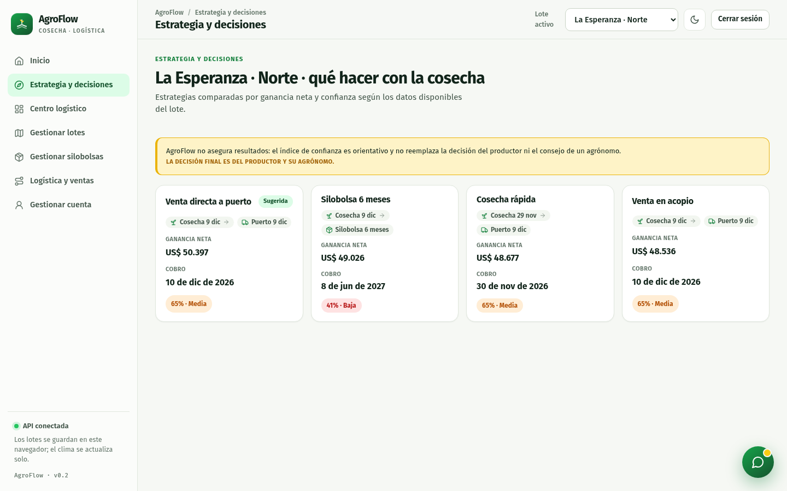 |
| **Centro logístico** · decisión, camiones, almacenaje y ganancia en una vista<br> | **Lotes y mapa** · límite del lote sobre mapa o satélite, con cálculo de hectáreas<br>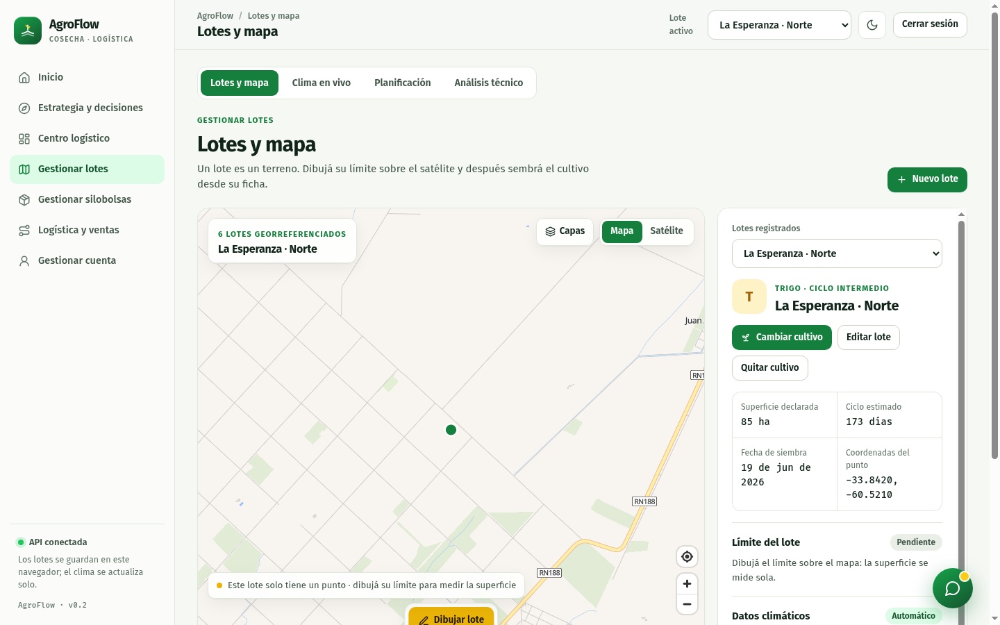 |
| **Clima en vivo** · pronóstico y capas climáticas sobre el mapa<br>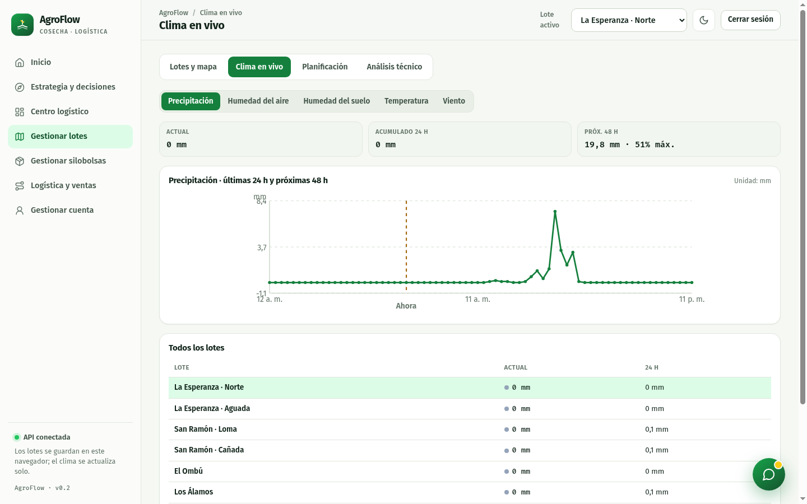 | **Planificación** · ciclo del cultivo y ventana de cosecha<br>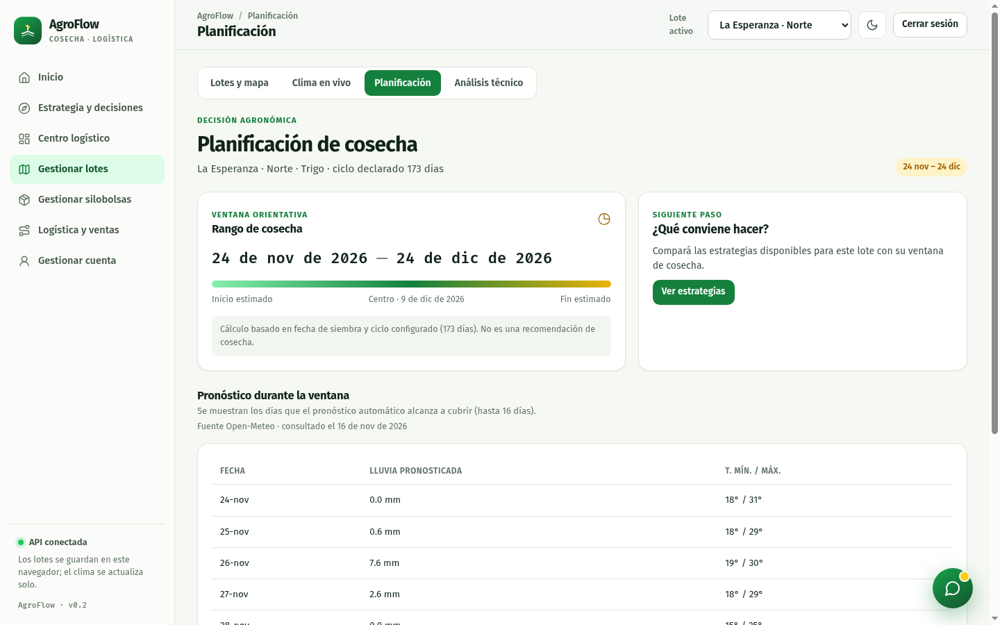 |
| **Silobolsas** · riesgo por CO₂, humedad y temperatura, y "sacar y vender"<br>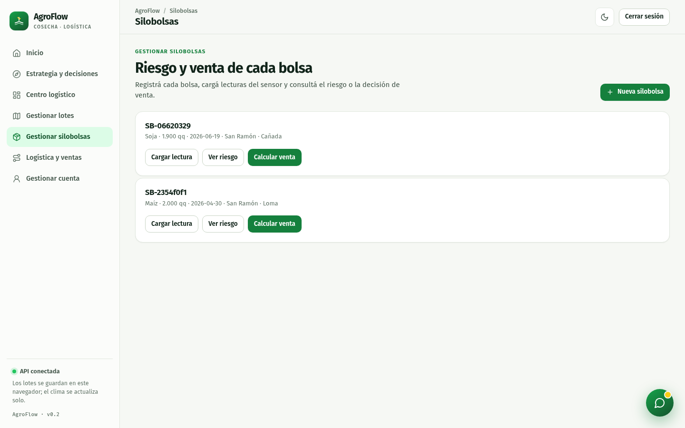 | **Marketplace** · ofertas de contratistas y transportistas<br>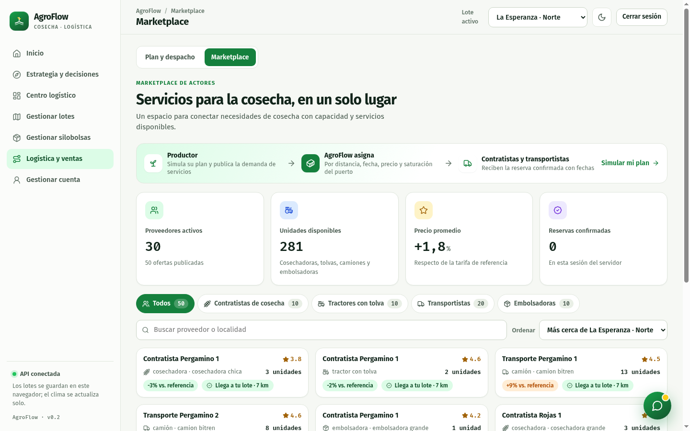 |

### Plan y despacho (tema oscuro)

Destino por margen neto, explicación (IA o plantilla de respaldo), saturación del puerto día por día y pedido de cadetes.

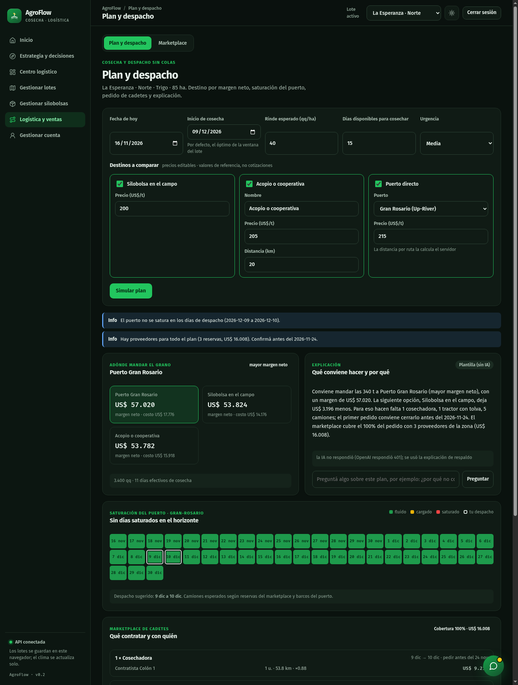

### Espacio del prestador de servicios

Oferta activa, solicitudes de cotización y estado de cada pedido.

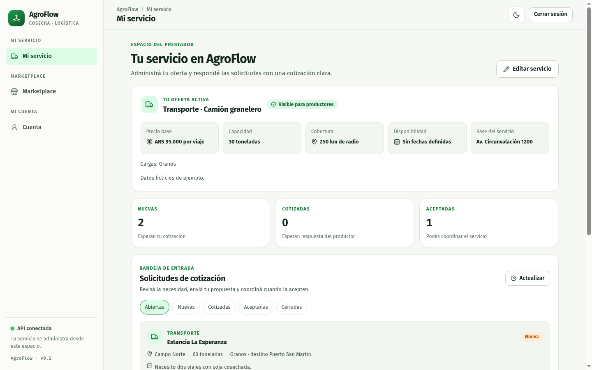

### Acceso y tema oscuro

| Ingreso con visitante productor o prestador | Estrategias en tema oscuro |
| --- | --- |
| 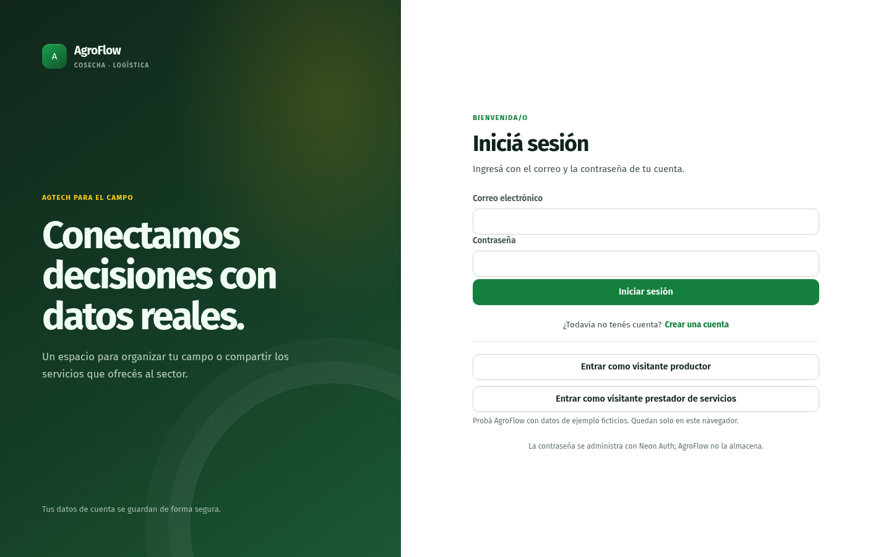 | 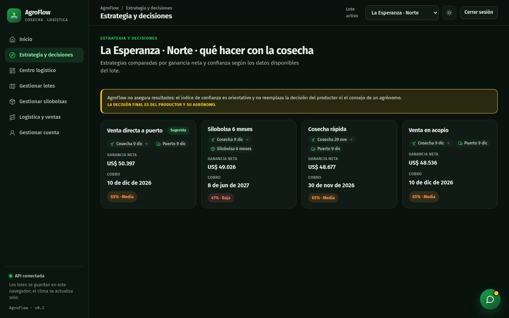 |

## Presentaciones

| Idioma | Archivo |
| --- | --- |
| Español | [docs/presentaciones/AgroFlow-presentacion.pptx](docs/presentaciones/AgroFlow-presentacion.pptx) |
| English | [docs/presentaciones/AgroFlow-presentation-en.pptx](docs/presentaciones/AgroFlow-presentation-en.pptx) |

---

## Problema

En el pico de cosecha miles de camiones llegan al mismo puerto los mismos días: en mayo de 2026 descargaron más de 850.000 camiones en el Gran Rosario. El productor decide cuándo cosechar, qué contratar y adónde mandar el grano sin ver esa cola. Paga la espera, el flete caro de la temporada alta, la merma y, a veces, malvende para no quedarse sin cupo.

## Solución

| Parte | Qué hace | Para quién |
| --- | --- | --- |
| **1. Simulador** | Con el lote (cultivo, ubicación, hectáreas, fechas): ventana de cosecha, destino por margen neto (puerto, acopio o silobolsa), cuándo vender y qué maquinaria y camiones hacen falta | Productor |
| **2. Marketplace de cadetes** | El plan se convierte en un pedido concreto (cosechadoras, tolvas, camiones, embolsadoras, con fechas). Se asigna a proveedores de la zona con disponibilidad y se reserva | Productor, contratistas y transportistas |
| **3. Pronóstico de saturación del puerto** | Día por día, la demanda de los barcos (fuente oficial) contra los camiones que van a llegar (reservas del marketplace). Si el despacho cae en días saturados, corre los camiones a la ventana fluida más cercana o recomienda acopio o silobolsa | Productor; a futuro, acopios y exportadores |

El turno de descarga en terminal lo siguen dando los sistemas existentes (Circular, Muvin): el marketplace se integra con ellos, no los reemplaza.

## Por qué es distinto

Existen piezas sueltas: turnos y cupos de camiones (Circular, Muvin), alertas de silobolsa (Wiagro, Silcheck, SiloReal), momento de venta (Hedgit) y line-ups para traders (Kpler, Argus). Ninguna une esas señales en **una decisión de margen neto para el productor** ni **dimensiona y contrata** la maquinaria del plan. Y nadie tiene el dato de los camiones **reservados** antes de salir. Detalle y fuentes en [docs/FRENTE.md](docs/FRENTE.md).

## Datos

| Tipo | Datos | Cómo entra |
| --- | --- | --- |
| **Propio** | Ofertas de proveedores y reservas confirmadas en el marketplace (camiones por puerto y día) | Marketplace |
| Oficial y abierto | Barcos anunciados por puerto y producto (MAGyP, line-up NABSA agregado), altura del Paraná (INA), clima (NASA POWER, Open-Meteo, IMERG, SMN), rinde histórico (datos.gob.ar), rutas (OpenStreetMap) | API, tabla pública o precarga |
| Publicado (complemento) | Line-up por buque (NABSA), buques a la carga y camiones a puerto (BCR), pizarra (CAC Rosario), futuros (A3) | PDF / Excel diario, parser propio |
| Manual del usuario | Cultivo, ubicación, hectáreas, fechas, maquinaria propia, humedad medida | Formulario |
| Supuesto editable | Precios de maquinaria, flete, silobolsa, acopio; ha/día por máquina; participación de mercado del marketplace | Valores de referencia |

Estado de cada fuente en [docs/DATOS.md](docs/DATOS.md) y [docs/FUENTES.md](docs/FUENTES.md).

## Cómo correrlo

Requisitos: Node 22.23.5, la versión fijada en `package.json` y `.nvmrc`. Para actualizar el flete desde el PDF de CATAC hace falta `pdftotext` (paquete `poppler-utils`).

```bash
git clone https://github.com/juanachies/AgroFlow.git
```

```bash
cd AgroFlow
```

```bash
npm test
```

```bash
npm run demo
```

`demo` recorre el producto completo con un lote de soja cerca de Pergamino en el pico de abril: destino por margen neto, saturación del puerto día por día, corrimiento del despacho para evitar la cola, asignación del pedido a proveedores del marketplace (ficticios) y confirmación de reservas.

Para levantar la API (el front la consume; documentación en [docs/API.md](docs/API.md)):

```bash
npm start
```

Queda en `http://localhost:3000` (`GET /api/salud`). Si el front está compilado en `dist/` (`npm run build`), se sirve desde la misma URL. Para publicarlo: [docs/DESPLIEGUE.md](docs/DESPLIEGUE.md).

Otros comandos:

```bash
npm run demo:venta
```

`demo:venta` muestra la venta durante la cosecha con los índices del puerto y datos de mercado publicados la semana del 11/11/2026.

### Frontend web

La aplicación está implementada en React/JSX con Vite. En desarrollo se corren la API y el front, cada uno en su terminal (Vite manda `/api` a la API):

```bash
npm start
```

```bash
npm run dev
```

Para producción, el front compilado y la API salen por la misma URL:

```bash
npm run build
```

```bash
npm start
```

En la interfaz podés registrar lotes y sus puntos de referencia, importar límites GeoJSON y cargar snapshots climáticos generados por `npm run update:weather`. Los datos de lotes y snapshots se guardan en IndexedDB del navegador. La página **Plan y despacho** usa la API (`src/interfaces/web/lib/api.js`). Hace estas cuatro cosas:

1. Simula el plan del lote seleccionado: destino por margen neto, saturación del puerto con la ventana de despacho, y pedido asignado a proveedores del marketplace.
2. Explica el plan, con IA o con la plantilla de respaldo, y responde preguntas.
3. Corre escenarios "¿y si…?".
4. Confirma las reservas.

Ninguna key de API se usa desde el navegador.

El mapa base usa OpenFreeMap/OpenStreetMap y ofrece imágenes de Esri como alternativa, con atribución visible. Para generar una compilación de producción ejecutá `npm run build` (salida en `dist/`).

### Cuentas y despliegue en Vercel

El acceso usa Neon Auth y los perfiles se guardan en PostgreSQL mediante las funciones privadas de Vercel. Para el frontend configurá `VITE_NEON_AUTH_URL` con la URL pública de Neon Auth. Para las funciones configurá `DATABASE_URL` (solo servidor), `NEON_AUTH_BASE_URL` y `NEON_AUTH_JWKS_URL`. No uses el prefijo `VITE_` para credenciales de base de datos.

Antes del primer uso, aplicá el esquema con `npm run db:migrate:accounts`; el script local requiere `DATABASE_URL_UNPOOLED` en `.env.local`. Probá primero en una rama de desarrollo de Neon y verificá la URL antes de ejecutar migraciones en producción. En Neon Auth agregá el dominio de producción de Vercel a **Trusted Domains**. En Vercel usá preset Vite, `npm run build`, directorio de salida `dist` e instalación `npm install`.

El registro guarda primero el perfil básico. Luego los productores agregan campos por ciudad y dibujan su perímetro; la superficie y el punto de referencia se derivan del polígono. Los prestadores configuran su oferta por separado y marcan una ubicación aproximada en el mapa. La búsqueda de localidades se inicia explícitamente con Photon (OpenStreetMap), con atribución visible. Las coordenadas de campos y prestadores no se publican en el directorio ni en solicitudes pendientes; la aceptación de una cotización habilita el contacto entre las partes. Cada usuario solo puede consultar y modificar sus propios datos.

```bash
npm run actualizar-tarifas
```

`actualizar-tarifas` trae el dólar oficial y la tabla de flete de CATAC; si una fuente falla, conserva los valores anteriores. La API y el front se sirven juntos con `npm start`; la URL pública está arriba.

## Módulos

| Módulo | Qué decide | Código | Documento |
| --- | --- | --- | --- |
| Ventana de cosecha | Cuándo se puede cosechar (ciclo, clima, días aptos) | `domain/cosecha`, `domain/clima`, `consultarCondicionesCosecha`, `recomendador_cosecha.py` | [FUENTES.md](docs/FUENTES.md) |
| Maquinaria y plan de pedido | Cuántas cosechadoras, tolvas, camiones y embolsadoras, y cuándo pedirlas | `domain/maquinaria`, `planificarCosecha` | [MAQUINARIA.md](docs/MAQUINARIA.md) |
| Destino por margen neto | Puerto, acopio o silobolsa | `domain/destino`, `compararDestinos` | [PROYECTO.md](PROYECTO.md) |
| **Marketplace de cadetes** | A qué proveedores se asigna el plan; reservas | `domain/marketplace`, `simularPlan`, `confirmarReservas` | [MARKETPLACE.md](docs/MARKETPLACE.md) |
| **Saturación del puerto** | Qué días se satura el puerto y cuándo despachar | `domain/saturacion`, `domain/barcos` | [MARKETPLACE.md](docs/MARKETPLACE.md), [INDICES_PUERTO.md](docs/INDICES_PUERTO.md) |
| Venta | Vender ya o guardar (spot y futuros), y canal | `domain/venta`, `decidirVentaCosecha` | [VENTA.md](docs/VENTA.md), [PLAN_BARCOS.md](docs/PLAN_BARCOS.md) |
| Silobolsa | Riesgo por IoT (CO₂, humedad, temperatura) y "sacar y vender" | `domain/silobolsa`, `evaluarSilobolsa`, `decidirVenta` | [VENTA.md](docs/VENTA.md) |
| IA | Explica el plan y responde escenarios "¿y si…?" (lluvia, demora, precio, flete, saturación); no calcula. OpenAI con reintentos y plantilla de respaldo | `domain/ia`, `explicarRecomendacion`, `simularEscenario` | [API.md](docs/API.md) |

Todos los cálculos son código determinista y auditable. Internamente se calcula en toneladas y USD.

## Arquitectura

Hexagonal: las reglas del negocio viven en `src/domain`, sin red ni dependencias externas; lo externo entra por puertos (`src/application/ports`) y adaptadores (`src/infrastructure`). El marketplace es un puerto más (`MarketplacePort`), con un adaptador en memoria para la demo. Detalle en [docs/ARQUITECTURA.md](docs/ARQUITECTURA.md).

## Orden de entrega

- [x] Simulador: destino por margen neto, plan de pedido, venta y saturación del puerto
- [x] Marketplace de cadetes: asignación y reservas (en memoria)
- [x] API HTTP para el front (`npm start`)
- [x] Formulario del lote y vista del plan, desplegado con URL pública
- [ ] Persistencia del marketplace (base de datos) y alta de proveedores
- [x] Explicación con IA y escenarios (OpenAI con respaldo de plantilla)
- [x] Clima real (Open-Meteo) y distancias por ruta (OSRM) en el simulador
- [x] API de silobolsas (registro, lecturas del IoT, riesgo y venta) y venta en cosecha
- [x] Guion de demo de 2 minutos ([FRENTE.md](docs/FRENTE.md#7-guion-de-pitch-2-minutos))

## Pendientes

- Validar con productores y transportistas la participación de mercado mínima para que el pronóstico propio sea útil (hoy 5%, supuesto).
- Integración con Circular o Muvin para el turno de descarga.
- Fuente de ubicaciones de acopios, cooperativas y concesionarias.
- Tarifas vigentes: CATAC, FACMA, embolsado, silo profesional, alquiler de maquinaria.
- Calibrar los umbrales de saturación con la serie histórica de camiones de MAGyP y la BCR.

## Documentación

| Documento | Contenido |
| --- | --- |
| [docs/INFORME_NASA_SPACE_APPS.md](docs/INFORME_NASA_SPACE_APPS.md) | Informe de entrega (inglés) para NASA Space Apps: descripción, impacto, datos NASA, competencia y uso de IA |
| [docs/FRENTE.md](docs/FRENTE.md) | Posicionamiento, problema, diferencial frente a lo que existe, barreras y guion de pitch |
| [docs/MARKETPLACE.md](docs/MARKETPLACE.md) | Marketplace de cadetes, reservas y pronóstico de saturación del puerto |
| [docs/API.md](docs/API.md) | API HTTP para el front: endpoints, entradas, respuestas y errores |
| [docs/DESPLIEGUE.md](docs/DESPLIEGUE.md) | URL pública: servidor con pm2 o Docker, variables de entorno y datos reales |
| [PROYECTO.md](PROYECTO.md) | Plan técnico original: módulos, fórmulas, flujo, datos, reglas del evento |
| [docs/ARQUITECTURA.md](docs/ARQUITECTURA.md) | Arquitectura hexagonal y árbol de carpetas |
| [docs/DATOS.md](docs/DATOS.md) | Estado de cada dato, supuestos y cifras de referencia |
| [docs/FUENTES.md](docs/FUENTES.md) | Conectores, configuración y límites de las fuentes externas |
| [docs/MAQUINARIA.md](docs/MAQUINARIA.md) | Catálogo de maquinaria, dimensionado y plan de pedido |
| [docs/VENTA.md](docs/VENTA.md) | Venta de silobolsa, precios por curva y venta en acopio |
| [docs/PLAN_BARCOS.md](docs/PLAN_BARCOS.md) | Módulo de barcos (insumo de la saturación) y venta en cosecha |
| [docs/INDICES_PUERTO.md](docs/INDICES_PUERTO.md) | Índices del puerto y fuentes de datos de barcos |
| [docs/MODULO_5_BARCOS.md](docs/MODULO_5_BARCOS.md) | Método del módulo de barcos y avisos |

## Front + API en local

```bash
npm install
npm run dev:api   # API HTTP en http://localhost:3000
npm run dev       # front con Vite; /api se reenvía a la API
```

O todo en una sola URL: `npm run build && npm start` (el servidor sirve `dist/` y la API).

El front incluye tema claro/oscuro, dibujo y edición del límite del lote sobre el mapa (calcula la superficie en ha), plan logístico (`POST /api/simular` + `POST /api/reservas`), marketplace de contratistas y transportistas (`/api/ofertas`) y un asistente en burbuja de chat.
