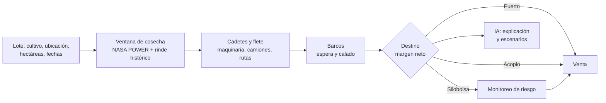

# marcianos · Asistente de cosecha y poscosecha

Le dice a un productor de la zona núcleo **cuándo cosechar, qué maquinaria contratar y adónde mandar el grano** (puerto, acopio o silobolsa) para ganar más, con clima real de la NASA y una IA que explica la recomendación en su idioma.

Desafío 02 · Logística de cosecha y poscosecha. Definición completa en [PROYECTO.md](PROYECTO.md).

> **Estado:** en construcción. La estructura del proyecto y la documentación están listas; el código se está escribiendo. Las secciones marcadas *(pendiente)* se completan antes de la entrega.

**URL pública:** *(pendiente)*

---

## El problema

En cosecha, cada día de demora y cada decisión de destino cuesta plata, y el productor decide con información dispersa:

- **Cuándo cosechar.** Esperar sube las pérdidas: en un ensayo de INTA Manfredi, demorar 33 días llevó la pérdida de 56 a 264 kg/ha.
- **Qué contratar.** Cuántas cosechadoras, tolvas y camiones, y si conviene tener camiones fijos en el campo o pagar por viaje.
- **Adónde va el grano.** El puerto paga ya pero cobra el flete más largo y puede haber cola; el acopio cobra tarifa; la silobolsa no paga flete inicial pero arriesga merma.
- **Cuándo vender lo guardado.** Guardar conviene solo si el precio sube más de lo que cuesta guardar.

La escala del problema en el Gran Rosario:

| Cifra | Valor |
| --- | --- |
| Camiones que entraron al polo exportador en 2025 | ~760.000 |
| Pico de camiones por día en cosecha | ~5.500 |
| Grano que viaja en camión | ~77% |
| Peso del flete en el precio del maíz lejano | hasta ~32% |
| Grano en silobolsas tras la cosecha gruesa | ~40 millones de t |
| Silobolsas con problemas de conservación | 5 a 8% |

Fuentes y advertencias en [docs/DATOS.md](docs/DATOS.md#cifras-de-referencia-para-el-pitch).

## Qué hace

El productor carga su lote y el asistente responde, con números:

1. **Ventana de cosecha:** inicio, momento óptimo y fin, con el rinde estimado y los días que se pierden por lluvia.
2. **Cadetes:** la maquinaria a contratar (cosechadoras, tractores, tolvas, camiones, embolsadora) según el tiempo disponible, y qué modalidad de camión sale más barata.
3. **Destino:** margen neto de cada opción (puerto directo, acopio o cooperativa, silobolsa) para varias fechas de venta, y cuál gana.
4. **Silobolsa:** riesgo de deterioro según humedad al embolsar, temperatura y tiempo, con aviso de "conviene sacar y vender ya".
5. **Barcos:** cuándo hay un buque que reciba el grano en la terminal y cuánto cuesta esperarlo, ajustado por el nivel del río.
6. **IA:** explica la recomendación y responde escenarios como "¿y si llueve 10 días más?". No calcula: los números salen de código determinista y auditable.

### Fórmula central

```
margen(destino, fecha) = toneladas × precio(fecha)
                         − flete − almacenaje − secado − merma esperada
                         − costo financiero − costo de demora o cola
```

Se evalúa para cada destino y fecha de venta; gana el mayor. Detalle de cada módulo en [PROYECTO.md](PROYECTO.md#módulos).

## Flujo



## Arquitectura

Hexagonal (puertos y adaptadores) en Node con módulos ES. Las reglas del negocio viven en `src/domain`, sin red ni dependencias externas. Cada servicio externo entra por un puerto y tiene un adaptador de respaldo, para que la demo funcione aunque falle una API.

```
src/
├── domain/           reglas puras: cosecha, clima, maquinaria, flete, destino, silobolsa, barcos, venta
├── application/      puertos (contratos) y casos de uso
├── infrastructure/   adaptadores: NASA POWER, OSRM, datos.gob.ar, OpenAI, CSV y simulados
├── interfaces/       API HTTP y web
└── config/           conexión de casos de uso con adaptadores y lectura de ~/.env
data/                 localidades, terminales, acopios, tarifas, barcos simulados
tests/                tests de dominio y de casos de uso
docs/                 arquitectura y datos
```

Árbol completo, diagrama y tabla de módulo a carpeta en [docs/ARQUITECTURA.md](docs/ARQUITECTURA.md).

### API *(pendiente)*

| Método y ruta | Caso de uso | Devuelve |
| --- | --- | --- |
| `POST /api/plan` | planificarCosecha | Ventana de cosecha, toneladas, maquinaria y camiones |
| `POST /api/destinos` | compararDestinos | Margen neto por destino y fecha, y el recomendado |
| `POST /api/silobolsa` | evaluarSilobolsa | Riesgo y fecha límite de venta |
| `POST /api/venta` | decidirVenta | Vender ahora o esperar, y el spread de equilibrio |
| `POST /api/explicar` | explicarRecomendacion | Explicación en lenguaje de productor |

## Datos

| Origen | Datos |
| --- | --- |
| Automático y abierto | NASA POWER (lluvia, temperatura, humedad, humedad del suelo), datos.gob.ar (rinde histórico), OpenStreetMap (rutas) |
| Manual del usuario | Cultivo, ubicación, hectáreas, fechas, maquinaria propia, humedad medida |
| Supuesto editable | Precios, tarifas y capacidades de máquinas |
| Sin fuente abierta | Arribos de barcos y ubicación de acopios: manual o simulado |

- **NASA POWER funciona** sin cuenta y es la fuente de clima de la demo.
- **GPM IMERG** (lluvia a 10 km) tiene la cuenta lista, pero su servidor no respondía desde nuestra red: queda como mejora.
- **SWOT** (nivel del Paraná) y **SMAP** (humedad del suelo) piden cuenta de Earthdata y no están probados.

Estado de cada dato, URLs de ejemplo y supuestos en [docs/DATOS.md](docs/DATOS.md).

## Cómo correrlo *(pendiente)*

Requisitos: Node *(versión del Cloud Server, pendiente)*.

```bash
git clone https://github.com/juanachies/marcianos.git
```

```bash
cd marcianos
```

```bash
npm install
```

```bash
npm start
```

La key de OpenAI va en `~/.env`, fuera del proyecto:

```
OPENAI_API_KEY=...
```

Sin key, la explicación usa una plantilla de respaldo y el resto funciona igual.

Tests:

```bash
npm test
```

## Decisiones

- **La IA explica, no calcula.** Los números salen de funciones puras y testeables; la IA recibe el resultado y lo traduce. Así el jurado puede auditar cada cifra.
- **Arquitectura hexagonal.** Si una API falla en la demo, se cambia el adaptador por uno simulado sin tocar la lógica.
- **NASA POWER antes que IMERG.** POWER no pide cuenta y respondió siempre; IMERG tiene mejor resolución pero su servidor no respondía desde nuestra red.
- **JavaScript con módulos ES, sin TypeScript.** Evita un paso de compilación en el servidor con poco tiempo de desarrollo.
- **Precios y tarifas como supuestos editables.** No hay fuente 2026 abierta para la mayoría; se precargan valores de referencia y se dice en la demo.
- **Unidades internas en toneladas y USD.** qq/ha y pesos solo en la vista.

## Avance

- [x] Definición del proyecto ([PROYECTO.md](PROYECTO.md))
- [x] Estructura hexagonal y documentación ([docs/](docs/))
- [ ] Formulario del lote y tabla de destinos con margen neto, desplegado con URL pública
- [ ] Ventana de cosecha con clima real de NASA POWER
- [ ] Cadetes (maquinaria y camiones) y flete por ruta
- [ ] Monitoreo y riesgo de silobolsa
- [ ] Barcos: calendario simulado y regla de calado
- [ ] Explicación con IA y escenarios
- [ ] Guion de demo de 2 minutos

## Demo en 2 minutos *(pendiente)*

Guion a completar con la versión desplegada. Estructura propuesta:

1. **El problema (20 s):** un productor de Pergamino con 500 ha de soja y un temporal en camino.
2. **Carga del lote (20 s):** cultivo, ubicación en el mapa, hectáreas y fechas.
3. **Ventana y cadetes (25 s):** cuándo cosechar con la lluvia real de NASA POWER y qué maquinaria contratar.
4. **Destino (30 s):** tabla de margen neto por destino; el recomendado y por qué.
5. **IA y escenario (25 s):** "¿y si llueve 10 días más?" y cómo cambia la recomendación.

## Documentación

| Documento | Contenido |
| --- | --- |
| [PROYECTO.md](PROYECTO.md) | Definición completa: problema, módulos, fórmulas, flujo, reglas del evento |
| [docs/ARQUITECTURA.md](docs/ARQUITECTURA.md) | Arquitectura hexagonal, árbol de carpetas, módulo a carpeta |
| [docs/DATOS.md](docs/DATOS.md) | Qué datos tenemos, cuáles faltan, supuestos y cifras de referencia |
