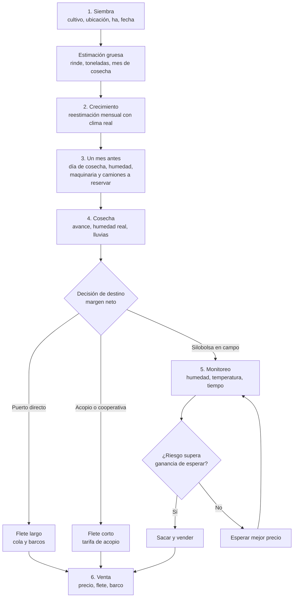

# marcianos · Logística de cosecha y poscosecha

Asistente de decisión para el productor: **cuándo se va a poder cosechar, qué maquinaria y camiones pedir, adónde mandar el grano y cuándo venderlo**, optimizando el margen neto.

Desafío 02 del Hackatón Nasa Space Apps. El plan completo está en [PROYECTO.md](PROYECTO.md); este README lo resume.

**URL pública:** *(pendiente)*

---

## Problema

Un productor siembra un cultivo y necesita decidir, con la información disponible en cada momento:

1. Cuándo se va a poder cosechar.
2. Cuándo y cuántos camiones pedir, y de qué tipo.
3. Adónde va el grano: puerto directo, silobolsa o silo profesional.
4. Si ya está embolsado, cuándo conviene sacarlo y venderlo antes de que se deteriore.

El objetivo es el **margen neto** y la **toma de decisiones**. Cubre los ejes A (silobolsas), B (tiempos muertos) y D (combustible y flete) del desafío.

## Qué carga el usuario

- Cultivo: soja, maíz o trigo.
- Ubicación del campo (punto en el mapa o coordenadas): define distancias, clima y rinde.
- Hectáreas. El rinde lo estima el sistema.
- Fecha de siembra y fecha límite para terminar la cosecha.
- Maquinaria propia, si la hay: cosechadoras, tractores, tolvas, camiones, embolsadora. Lo que falte se contrata.
- Precios editables: máquinas y servicios, silobolsa, silo o acopio, flete, grano.
- Llegada de barcos al puerto: manual al inicio.
- Humedad del grano, medida o estimada.

Internamente se calcula en toneladas y USD. El rinde se muestra en qq/ha (1 qq = 100 kg); ARS como conversión opcional.

## Módulos

### 1. Ventana de cosecha

- **Rinde esperado:** promedio de los últimos 5 años por departamento ([datos.gob.ar](https://datos.gob.ar/dataset?tags=agricultura)), corregido por la lluvia del año.
- **Madurez:** ciclo en días, editable por cultivo y variedad.
- **Salida:** inicio, óptimo y fin. Meses si falta mucho, semanas a ~2 meses, días a ~1 mes.
- **Reglas de INTA Manfredi:** base de recibo 13,5% de humedad; cosechar con 15% reduce a la mitad las pérdidas por desgrane; ~70% de las pérdidas ocurren en la plataforma; demorar 33 días subió la pérdida de 56 a 264 kg/ha en un ensayo.

### 2. Maquinaria, tiempo y flete

Los **cadetes** son toda la maquinaria de cosecha, transporte y armado de silobolsas: cosechadoras, tractores, tolvas, camiones y embolsadoras.

```
toneladas     = hectáreas × rinde
días          = fecha límite − inicio de cosecha − días de lluvia esperados
cosechadoras  = ceil(hectáreas ÷ (ha/día por cosechadora × días))
```

Camiones, dos modalidades; gana la más barata:

- **A. Dedicados al campo** (contrato por día): camiones × días × tarifa diaria. Conviene en distancias cortas.
- **B. Por viaje** (por viaje o por t/km): ciclo = 2 × distancia ÷ velocidad + carga + descarga + cola. Conviene en distancias largas.

Flete = toneladas × distancia por ruta × tarifa por t/km (referencia CATAC). La distancia sale de OpenStreetMap, no en línea recta.

### 3. Decisión de destino

```
margen(opción) = t × precio(fecha) − flete − almacenaje − secado
                 − merma esperada − costo financiero − costo de demora o cola
```

Se evalúa para cada destino y varias fechas de venta; gana el máximo.

| Destino | A favor | En contra |
| --- | --- | --- |
| Silobolsa en el campo | Sin flete inicial | Bolsa, embolsado, extracción y riesgo de merma; el flete se paga al vender |
| Acopio, cooperativa o concesionaria | Flexibilidad | Tarifa de acopio, secado y merma por manipuleo |
| Puerto directo | Cobra ya | Flete más largo y posible cola; depende de los barcos (módulo 5) |

Guardar conviene solo si el spread de precio supera el costo de guardar.

### 4. Monitoreo de silobolsa

Plazo seguro según humedad al embolsar (INTA):

| Humedad al embolsar | Riesgo bajo | Riesgo medio | Riesgo alto |
| --- | --- | --- | --- |
| Hasta 14% | 6 meses | 12 meses | 18 meses |
| 14 a 16% | 2 meses | 6 meses | 12 meses |
| Más de 16% | 1 mes | 2 meses | 3 meses |

Sobre 20 °C el riesgo sube; también influyen la hermeticidad y las roturas. Salida: aviso de **"conviene sacar y vender ya"** cuando el costo esperado del deterioro supera la ganancia de esperar.

### 5. Barcos en el puerto

Estima cuándo habrá barcos para cargar y lo contrasta con la fecha en que el grano llega al puerto. Si llega antes, hay cola y costo de espera, o conviene guardar. Al inicio el calendario de arribos es manual o simulado; el nivel del Paraná (SWOT) puede afectar el calado y el flete fluvial.

### Decisión de venta en el último mes

```
vender_ahora    = t × precio_hoy − flete_hoy
esperar_a(t_i)  = t × (1 − merma_i) × E[precio_i] − flete_i − costo_guardar_i − interés_i
decisión        = argmax entre vender_ahora y cada esperar_a(t_i)
```

Considera precio disponible contra futuro, barcos y cola, costos de esperar y restricciones (cupo del acopio, camiones, lluvia). La salida incluye el **spread mínimo de equilibrio**: cuánto tiene que subir el precio para que guardar convenga.

### 6. IA

- **No calcula:** los números salen de código determinista y auditable.
- Explica la recomendación en lenguaje de productor, justifica el trade-off y responde escenarios como "¿y si llueve 10 días más?".
- Usa OpenAI con reintentos y manejo de límites, porque la key es compartida.

## Flujo: de la siembra a la venta



| Etapa | Qué se estima | Datos |
| --- | --- | --- |
| 1. Siembra | Rinde (rango amplio), toneladas, mes de cosecha, maquinaria preliminar | Rinde histórico, clima histórico (NASA POWER), ciclo del cultivo |
| 2. Crecimiento | Se acotan la fecha y el rinde según cómo viene el año | Lluvia acumulada, temperatura |
| 3. Un mes antes | Día de cosecha, humedad esperada, cosechadoras y camiones a reservar | Pronóstico de lluvia, ha/día por máquina, distancia por ruta, tarifas |
| 4. Cosecha | Avance diario, pérdida por demora, destino de cada tanda | Humedad medida, lluvias, precio, flete, acopios, barcos |
| 5. Silobolsa | Riesgo de deterioro y fecha límite de venta | Humedad al embolsar, temperatura y humedad ambiente, meses guardado |
| 6. Venta | Mejor fecha y destino, margen neto final | Precio hoy y a futuro, flete, barcos, costo de guardar y financiero |

## Datos

| Tipo | Datos | Cómo entra |
| --- | --- | --- |
| Automático y abierto | Clima (NASA POWER), lluvia (GPM IMERG), nivel del Paraná (SWOT), rinde histórico (datos.gob.ar), rutas (OpenStreetMap) | API o precarga |
| Manual del usuario | Cultivo, ubicación, ha, fechas, maquinaria propia, humedad medida | Formulario |
| Supuesto editable | Precios de maquinaria, flete, silobolsa, acopio, grano, ha/día por máquina, capacidad del camión | Valores de referencia precargados |
| Sin fuente abierta | Arribo de barcos, cola de puerto, ubicación de acopios | Manual o simulado |

Precios y tarifas son supuestos editables con valores de referencia. Estado real de cada fuente (qué funciona, qué pide cuenta, qué no respondió) en [docs/DATOS.md](docs/DATOS.md).

## Cómo correrlo

Requisitos: Node 22 o superior. Para actualizar el flete desde el PDF de CATAC hace falta `pdftotext` (paquete `poppler-utils`).

```bash
git clone https://github.com/juanachies/marcianos.git
```

```bash
cd marcianos
```

```bash
npm test
```

```bash
npm run actualizar-tarifas
```

`actualizar-tarifas` trae el dólar oficial y la tabla de flete de CATAC; si una fuente falla, conserva los valores anteriores. El servidor web y la URL pública están *(pendientes)*.

Las keys (OpenAI) van en `~/.env`, nunca dentro del proyecto.

## Arquitectura

Hexagonal: las reglas del negocio viven en `src/domain`, sin red ni dependencias externas; lo externo entra por puertos (`src/application/ports`) y adaptadores (`src/infrastructure`). Detalle en [docs/ARQUITECTURA.md](docs/ARQUITECTURA.md); maquinaria, costos y plan de pedido en [docs/MAQUINARIA.md](docs/MAQUINARIA.md).

## Orden de entrega

- [ ] Formulario del lote y tabla comparativa de destinos con margen neto, desplegado con URL pública
- [ ] Ventana de cosecha con clima real (NASA POWER, IMERG)
- [ ] Camiones y flete
- [ ] Monitoreo y riesgo de silobolsa
- [ ] Explicación con IA y escenarios
- [ ] README mínimo y guion de demo de 2 minutos

## Pendientes

- Fuente de ubicaciones de acopios, cooperativas y concesionarias.
- Método de predicción de barcos en el puerto.
- Capacidad ha/día por cosechadora y capacidad de la embolsadora.
- Tarifas vigentes: CATAC, FACMA, embolsado, silo profesional, alquiler de maquinaria.
- Ciclo en días por cultivo.

## Documentación

| Documento | Contenido |
| --- | --- |
| [PROYECTO.md](PROYECTO.md) | Plan completo: problema, módulos, fórmulas, flujo, datos, reglas del evento |
| [docs/ARQUITECTURA.md](docs/ARQUITECTURA.md) | Arquitectura hexagonal y árbol de carpetas |
| [docs/DATOS.md](docs/DATOS.md) | Estado de cada dato, supuestos y cifras de referencia |
| [docs/MAQUINARIA.md](docs/MAQUINARIA.md) | Catálogo de maquinaria, dimensionado y plan de pedido |
