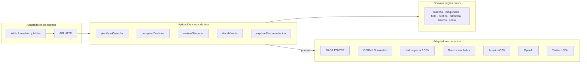

# Arquitectura: hexagonal (puertos y adaptadores)

Node con módulos ES (`"type": "module"`), sin framework de servidor pesado. Las reglas del negocio (margen, ventana de cosecha, riesgo de silobolsa, barcos) viven en un núcleo que no sabe nada de HTTP, NASA ni OpenAI. Todo lo externo entra por **puertos** y se conecta con **adaptadores** intercambiables.

Por qué conviene para hoy: si la API de NASA POWER, OSRM u OpenAI fallan en la demo, se cambia el adaptador por uno simulado sin tocar la lógica.

## El hexágono



**Regla de dependencias:** `domain` no importa nada del proyecto. `application` importa `domain` y define los puertos. `infrastructure` implementa los puertos. `interfaces` solo llama casos de uso. `config/container.js` es el único lugar que conecta casos de uso con adaptadores.

## Árbol de carpetas

```
marcianos/
├── package.json                  # "type": "module", "engines": { "node": "<versión del Cloud Server>" }
├── .gitignore                    # node_modules, data/cache, .env
├── README.md
├── PROYECTO.md
├── docs/
│   ├── ARQUITECTURA.md
│   └── DATOS.md
├── data/                         # datos de referencia versionados
│   ├── localidades.csv
│   ├── terminales.csv
│   ├── acopios.csv               # lista curada de la zona de demo
│   ├── tarifas.json              # supuestos editables con valores de referencia
│   ├── barcos-simulados.json
│   └── cache/                    # respuestas de APIs (no se versiona)
├── src/
│   ├── domain/                   # reglas puras: sin fetch, sin fs, sin fechas del sistema
│   │   ├── shared/               unidades.js (qq ↔ t, USD), errores.js
│   │   ├── lote/                 lote.js, cultivos.js (ciclo en días editable)
│   │   ├── clima/                corteCaminos.js (20 mm en 48 h), diasDeLluvia.js
│   │   ├── cosecha/              ventanaCosecha.js, perdidasPorDemora.js (reglas INTA Manfredi)
│   │   ├── maquinaria/           dimensionado.js (cosechadoras, tolvas, embolsadora), camiones.js (modalidad A vs B)
│   │   ├── flete/                costoFlete.js
│   │   ├── destino/              margen.js, comparadorDestinos.js
│   │   ├── silobolsa/            riesgoSilobolsa.js (tabla INTA por humedad y temperatura)
│   │   ├── barcos/               colaBuques.js, calado.js, indicesMercado.js, lineup.js, calendario.js
│   │   ├── marketplace/          ofertas.js, asignacion.js (asignar el plan de pedido, reservas)
│   │   ├── saturacion/           saturacionPuerto.js (barcos + camiones reservados, ventana de entrega)
│   │   └── venta/                decisionVenta.js (puerto / acopio / silobolsa, hasta dónde rinde), criterios.js (índices a cumplir para vender a puerto)
│   ├── application/
│   │   ├── ports/                # contratos (JSDoc): qué necesita la app del mundo
│   │   │   ├── ClimaPort.js          lluviaHoraria(), temperatura(), humedadSuelo()
│   │   │   ├── RindePort.js          rindeHistorico(departamento, cultivo)
│   │   │   ├── RutasPort.js          distanciaKm(origen, destino), geocodificar(texto)
│   │   │   ├── BarcosPort.js         calendario(terminal, desde, hasta), mercado(puerto, fecha)
│   │   │   ├── MarketplacePort.js    ofertas(filtro), reservas(filtro), reservar(reservas)
│   │   │   ├── PreciosPort.js        precios(cultivo)
│   │   │   ├── NivelRioPort.js       nivel(fecha)
│   │   │   ├── AcopiosPort.js        cercanos(punto, radioKm)
│   │   │   ├── TarifasPort.js        vigentes()
│   │   │   ├── ExplicadorPort.js     explicar(resultado, pregunta)
│   │   │   └── CachePort.js
│   │   └── usecases/
│   │       ├── simularPlan.js            # producto central: plan + saturación + marketplace; confirmarReservas
│   │       ├── decidirVentaCosecha.js    # venta en cosecha según barcos
│   │       ├── planificarCosecha.js      # módulos 1 y 2
│   │       ├── consultarCondicionesCosecha.js # meteorología y consolidación de fallos opcionales
│   │       ├── compararDestinos.js       # módulo 3, usa barcos (módulo 5)
│   │       ├── evaluarSilobolsa.js       # módulo 4
│   │       ├── decidirVenta.js           # decisión del último mes
│   │       ├── explicarRecomendacion.js  # módulo 6
│   │       └── simularEscenario.js       # "¿y si llueve 10 días más?"
│   ├── infrastructure/           # adaptadores de salida
│   │   ├── clima/                Open-Meteo, NASA POWER/IMERG/SMAP, SMN, ERA5-Land
│   │   ├── terreno/              Open-Meteo Elevation, OpenTopography
│   │   ├── satellite/            Copernicus STAC (Sentinel-1/2)
│   │   ├── rinde/                datosGobArAdapter.js
│   │   ├── rutas/                openStreetMapAdapter.js (Nominatim + OSRM)
│   │   ├── barcos/               barcosSimuladosAdapter.js, barcosManualAdapter.js, nabsaAdapter.js, bcrAdapter.js, magypAdapter.js (oficial)
│   │   ├── marketplace/          marketplaceMemoriaAdapter.js (en memoria + reservas simuladas del mercado)
│   │   ├── precios/              preciosManualAdapter.js, preciosSimuladosAdapter.js
│   │   ├── rio/                  nivelRioManualAdapter.js
│   │   ├── acopios/              acopiosCsvAdapter.js
│   │   ├── tarifas/              tarifasJsonAdapter.js
│   │   ├── ia/                   openaiAdapter.js (reintentos y límites: la key es compartida), explicadorPlantillaAdapter.js (respaldo sin IA)
│   │   ├── cache/                fileCache.js
│   │   └── http.js               timeout, reintentos y normalización de observaciones
│   ├── interfaces/               # adaptadores de entrada
│   │   ├── cli/                  refreshWeather.js (snapshot meteorológico diario)
│   │   ├── http/
│   │   │   ├── server.js
│   │   │   ├── routes/           plan.js, destinos.js, silobolsa.js, venta.js, explicar.js
│   │   │   └── validacion.js
│   │   └── web/                  index.html, app.js, styles.css
│   └── config/
│       ├── container.js          # arma los casos de uso con sus adaptadores
│       └── env.js                # lee ~/.env (las keys nunca van en el proyecto)
└── tests/
    ├── domain/                   # node:test, sin red
    ├── application/              # casos de uso con adaptadores simulados
    └── infrastructure/           # contratos externos probados con respuestas controladas
```

## De módulo del plan a carpeta

| Módulo de PROYECTO.md | Dominio | Caso de uso | Puertos |
| --- | --- | --- | --- |
| 1. Ventana de cosecha | `cosecha/`, `clima/`, `lote/` | `planificarCosecha` | Clima, Rinde |
| 2. Maquinaria, tiempo y flete | `maquinaria/`, `flete/`, `clima/` | `planificarCosecha` | Rutas, Tarifas, Clima |
| 3. Decisión de destino | `destino/`, `flete/` | `compararDestinos` | Rutas, Acopios, Tarifas, Barcos |
| 4. Monitoreo de silobolsa | `silobolsa/` | `evaluarSilobolsa` | Clima |
| 5. Barcos en el puerto (insumo de la saturación) | `barcos/` | `compararDestinos`, `decidirVenta`, `simularPlan` | Barcos, NivelRio |
| 7. Marketplace de cadetes y saturación del puerto | `marketplace/`, `saturacion/` | `simularPlan`, `confirmarReservas` | Marketplace, Barcos, Tarifas |
| Decisión de venta del último mes | `venta/` | `decidirVenta` | Tarifas, Barcos |
| 6. IA | — | `explicarRecomendacion`, `simularEscenario` | Explicador |

## Qué se reusa del prototipo en Python

| Prototipo | Destino en el repo |
| --- | --- |
| `nasa_power.py` (descarga con caché) | `infrastructure/clima/nasaPowerAdapter.js` + `infrastructure/cache/fileCache.js` |
| Regla de corte en `modelo.py` (20 mm en 48 h, secado 18 h, ×1,5 con suelo saturado) | `domain/clima/corteCaminos.js` |
| `distancia_km` y `tiempo_viaje_h` en `modelo.py` | `infrastructure/rutas/openStreetMapAdapter.js` (OSRM calcula la ruta vial) |
| `datos/localidades.csv`, `datos/terminales.csv` | `data/` |
| Simulador de colas y turnos | Tabla de cola esperada por fecha en `data/`, leída por el módulo de barcos y la modalidad B de camiones |
| Escenario real de mayo 2025 | `data/cache/` precargado para que la demo no dependa de la red |

## Convenciones

- **Dominio puro:** funciones que reciben datos y devuelven datos. Las fechas entran como parámetro, nunca `new Date()` adentro. Así se testea sin red y la IA recibe números auditables.
- **Un adaptador simulado por puerto externo:** la demo tiene que funcionar aunque falle una API.
- **Unidades internas:** toneladas y USD. qq/ha y ARS solo en la vista.
- **Errores:** los adaptadores traducen errores externos a errores del dominio (`DatoNoDisponible`); el caso de uso decide si usa el respaldo.
- **Tests:** `node --test` sobre `tests/domain` primero; son los cálculos que el jurado va a cuestionar.
- **Fuentes externas:** estado, autenticación, ejemplos de uso y limitaciones están en [`FUENTES.md`](./FUENTES.md). Los rasters que todavía requieren procesamiento no entran automáticamente al cálculo de transitabilidad.

## Cómo se creó la estructura

Las carpetas ya están en el repo, cada una con un `.gitkeep` porque Git no guarda carpetas vacías. Se crearon desde la raíz con:

```bash
mkdir -p data/cache docs tests/domain tests/application \
  src/domain/{shared,lote,clima,cosecha,maquinaria,flete,destino,silobolsa,barcos,venta} \
  src/application/{ports,usecases} \
  src/infrastructure/{clima,rinde,rutas,barcos,rio,acopios,tarifas,ia,cache} \
  src/interfaces/http/routes src/interfaces/web src/config
```

