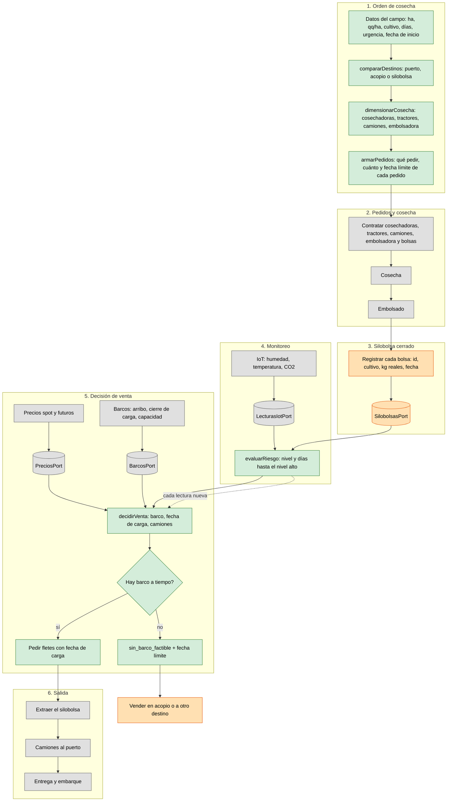

# Flujo completo: de la orden de cosecha al embarque en puerto

Verde: ya implementado y testeado. Naranja: falta o está incompleto. Gris: lo provee otro módulo o dispositivo.

## Qué falta

| # | Falta | Detalle | Efecto |
| --- | --- | --- | --- |
| 1 | Puente cosecha → silobolsa | `planificarCosecha` calcula cuántas bolsas, pero nada crea los registros que lee `SilobolsasPort` (id, kg reales, fecha de cierre). | La decisión de venta no se conecta sola con el plan de cosecha. |
| 2 | Costo y tiempo de extracción en la venta | `tarifas.json` tiene `extractora` (150 t/h) y `dimensionadoSilobolsa` calcula `costo_extraccion_usd`, pero `decisionVenta` no lo suma al neto ni reserva días de extracción. | El neto de cada barco está sobrestimado y la fecha de carga no considera cuánto tarda extraer. |
| 3 | Pedido de la extractora | `reserva.anticipo_dias` no tiene extractora; `armarPedidos` no la pide. | Falta un recurso en la lista de fletes y servicios a contratar. |
| 4 | Varias bolsas por lote | `decidirVenta` evalúa una bolsa por vez; la capacidad de un barco no se descuenta entre bolsas. | Dos bolsas pueden elegir el mismo barco y superar `toneladasMax`. |
| 5 | Re-evaluación automática | La decisión es una consulta puntual; nada la dispara con cada lectura nueva ni avisa cuando cambia. | Hay que llamarla a mano. |
| 6 | Alternativa sin barco | `sin_barco_factible` solo informa; no compara contra vender en acopio, que `compararDestinos` ya sabe evaluar. | El camino "no" del diagrama termina en una decisión manual. |
| 7 | Costos de esperar incompletos | El neto descuenta costo financiero, pero no almacenaje ni seguro; la merma usa el riesgo de hoy hasta la carga. | Esperar parece más barato de lo que es. |
| 8 | Adaptadores reales | Solo existe el de tarifas. Faltan IoT, precios, barcos y silobolsas (hoy hay simulados en los tests) y la interfaz HTTP. | El módulo no corre fuera de los tests. |
| 9 | Distancia y terminal separadas | `destino` lleva `terminal` y `distanciaKm` cargados a mano. | Sin `RutasPort`, un error de km cambia el flete. |
| 10 | Umbrales supuestos | Temperatura, CO₂ y merma por mes no tienen fuente abierta. | Validar con INTA antes de usar en serio. |

Prioridad sugerida: 2 y 3 (afectan el resultado de la decisión), después 1 y 4 (conectan el flujo), después 5 y 8 (lo hacen operable).
