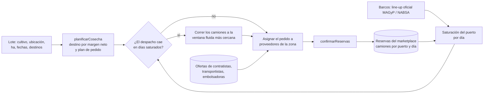

# Marketplace de cadetes y saturación del puerto

El simulador arma el plan del productor. El marketplace lo ejecuta con proveedores de la zona. Las reservas de camiones alimentan el pronóstico de saturación del puerto. Posicionamiento en [FRENTE.md](FRENTE.md).

## Flujo



Casos de uso (`src/application/usecases/simularPlan.js`):

| Caso de uso | Entrada | Salida |
| --- | --- | --- |
| `simularPlan` | Lote (`lote: {id, lat, lon}`), entrada de `planificarCosecha`, `hoy`, destinos | `plan` (con el pedido corrido si hace falta), `saturacion` día por día, `ventana` de despacho, `asignacion` a proveedores, `avisos` |
| `confirmarReservas` | Salida de `simularPlan` y `loteId` | Reservas creadas en el marketplace |

`simularPlan` no reserva nada: es la simulación que ve el productor. Recién `confirmarReservas` toma las unidades de cada proveedor y suma los camiones al pronóstico.

## Ofertas

Cada proveedor publica su capacidad (`domain/marketplace/ofertas.js`):

```js
{ id, proveedor, recurso, tipo, unidades, base: { lat, lon, localidad }, radioKm,
  disponibleDesde, disponibleHasta, precioRelativo, calificacion }
```

- `recurso`: `cosechadora`, `tractor con tolva`, `camión` o `embolsadora`. Son los mismos que arma el plan de pedido del equipo de maquinaria.
- `tipo`: los ids de `data/tarifas.json`, por ejemplo `camion-bitren` o `cosechadora-grande`.
- `precioRelativo`: 1 es la tarifa de referencia; 0,9 es 10% más barato.

Las ofertas de ejemplo (`data/marketplace-ofertas-ejemplo.json`) son **ficticias**: 50 proveedores en 10 localidades de la zona núcleo.

## Asignación

`asignarPlan` (`domain/marketplace/asignacion.js`) toma cada línea del plan de pedido y busca ofertas que:

1. sean del mismo recurso;
2. estén disponibles todo el rango de uso;
3. lleguen al lote (distancia a la base ≤ radio del proveedor);
4. tengan unidades libres todos esos días, descontando las reservas ya tomadas.

Prefiere el mismo tipo de equipo, el menor precio, la menor distancia y la mejor calificación, en ese orden. Puede repartir una línea entre varios proveedores, y nunca reserva dos veces las mismas unidades.

Lo que no se cubre queda como **faltante**, con una sugerencia: ampliar el radio, pedir antes o mover la fecha.

## Reservas

`crearReservas` convierte la asignación en reservas. Las de camiones guardan:

- el destino del grano;
- el **puerto**, si el destino es puerto;
- los **viajes por día** y la **capacidad del camión**.

Con eso se sabe cuántos camiones llegan a cada puerto cada día. Es el **dato propio** del producto.

## Pronóstico de saturación del puerto

`pronosticarSaturacion` (`domain/saturacion/saturacionPuerto.js`), para cada día:

```
camiones esperados = camiones reservados ÷ participación de mercado del marketplace
                     (si no hay reservas: dato publicado del día, si se carga)
saturación         = camiones esperados ÷ camiones de un día pico (7.000)
demanda ÷ oferta   = t/día que cargan los barcos del cultivo ÷ t/día del cultivo en camión
                     (solo si se indica qué fracción de los camiones lleva ese cultivo)
estado             = saturado  si saturación > 0,85, demanda ÷ oferta < 0,8 o espera > 3 días
                     cargado   si saturación > 0,6, demanda ÷ oferta < 1,1 o espera > 1 día
                     fluido    en otro caso
```

La demanda de los barcos y la espera salen del módulo de barcos ([PLAN_BARCOS.md](PLAN_BARCOS.md)). Las toneladas programadas salen de la tabla oficial de MAGyP ("Barcos anunciados", que es el line-up de NABSA agregado) o del line-up por buque.

`mejorVentanaDeEntrega` busca, hasta ±N días alrededor del despacho previsto, la ventana con menos días saturados. A igualdad, elige la de menor corrimiento.

En `simularPlan` **solo se mueven los camiones**: la cosecha queda en su fecha y el grano espera en el campo (tolva o silobolsa temporal). Si no hay ninguna ventana mejor, el aviso recomienda evaluar acopio o silobolsa.

## Puerto y adaptadores

`MarketplacePort` (`src/application/ports/MarketplacePort.js`):

| Método | Qué hace |
| --- | --- |
| `ofertas({ desde, hasta, recurso? })` | Ofertas disponibles en el rango |
| `reservas({ desde, hasta, puerto? })` | Reservas confirmadas que se superponen con el rango |
| `reservar(reservas)` | Confirma reservas nuevas; rechaza ids repetidos |

Adaptador para la demo: `crearMarketplaceMemoriaAdapter` (`src/infrastructure/marketplace/`), en memoria.

`simularReservasMercado` genera reservas agregadas del "resto del mercado", con picos configurables, para que la demo muestre saturación. Una base de datos real entra como otro adaptador del mismo puerto.

## Supuestos

| Supuesto | Valor | Dónde |
| --- | --- | --- |
| Participación de mercado del marketplace | 5% | `PARAMS_SATURACION.participacionMercado` |
| Camiones en un día pico del Gran Rosario | 7.000 | `PARAMS_SATURACION.camionesDiaPico` |
| Umbrales de saturación | 0,6 / 0,85 | `PARAMS_SATURACION` |
| Ventana de búsqueda del despacho | ±10 días | `margenDiasDespacho` en la entrada |
| Proveedores, precios y calificaciones | Ficticios | `data/marketplace-ofertas-ejemplo.json` |

## Límites actuales

- **Persistencia:** el marketplace vive en memoria; falta una base de datos y el alta de proveedores.
- **Distancia:** la asignación usa la distancia en línea recta a la base del proveedor; el flete sigue usando la distancia por ruta.
- **Escala del pronóstico:** con pocas reservas, dividir por la participación de mercado amplifica el error. Hay que combinarlo con el dato publicado de camiones hasta que la participación sea real.
- **Turno en terminal:** no se pide; está pensado como integración con Circular o Muvin.
