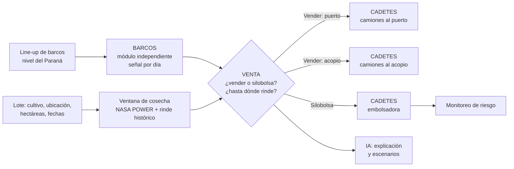

# Plan: Barcos como módulo aparte para decidir vender o silobolsa

**Barcos** es un módulo independiente: solo predice barcos y entrega una señal. **Venta** usa esa señal para decidir si vender (a puerto o acopio) o mandar a silobolsa, y calcula **hasta dónde rinde** vender. **Cadetes** recibe la decisión y dice qué maquinaria pedir, cuánta, cuándo y adónde.

## 1. Flujo



## 2. Módulos y contratos

Ubicados en la arquitectura hexagonal del repo ([ARQUITECTURA.md](ARQUITECTURA.md)):

```
src/
  domain/barcos/       analizarBarcos() -> { disponibilidad, senal[], calado, avisos }   no importa a venta ni cadetes
                       colaBuques.js, calado.js, indicesMercado.js, lineup.js, datos.js
  domain/venta/        decidirVentaCosecha({ barcos, mercado, curvaPrecios, ... }) -> { decision, canal, indicesPuerto, mejorVenta,
                       silobolsa, hastaDondeRinde, curva, avisos }; criterios.js (índices a cumplir)
  domain/maquinaria/   cadetes.js: avisoCadetes({ venta, ... }) -> { destino, camiones | embolsadoras, pedirEl, aviso }
  domain/shared/       util.js (fechas, normal)
  application/ports/   BarcosPort (calendario, mercado), NivelRioPort (nivel)
  application/usecases/decidirVentaCosecha.js   planificarVentaCosecha() puro + crearDecidirVentaCosecha({ barcos, nivelRio, respaldoBarcos, precios })
  infrastructure/barcos/   nabsaAdapter, bcrAdapter, barcosManualAdapter (CSV), barcosSimuladosAdapter (respaldo)
  infrastructure/rio/      nivelRioManualAdapter
  config/container.js      conecta el caso de uso con los adaptadores
```

### Barcos: la señal (contrato entre Barcos y Venta)

Por cada día del horizonte (60 días), lo que pasaría si el grano llega al puerto ese día:

| Campo | Significado |
|---|---|
| `probHayBarco` | P(hay barco cargando el cultivo ese día) |
| `esperaDias` | Espera esperada hasta tener barco si el grano llega ese día |
| `indiceDemanda` | Barcos presentes ÷ lo normal del mes |
| `factorPrecio` | Ajuste del disponible por la demanda de barcos: 1 + 0,03 × clamp(índice − 1, −1, 1) |
| `capacidadT` | Toneladas que pueden embarcar, ajustadas por calado |
| `confiable`, `fuente` | Si el horizonte alcanza y si el dato viene del line-up, es mixto o es estacional |

Barcos además entrega sus avisos: bajante, poca disponibilidad, riesgo de perder el barco contratado y baja confianza. Se puede usar solo, por ejemplo en un panel de barcos, sin Venta.

### Venta: vender o silobolsa

Para cada fecha de despacho posible, desde que el grano está listo hasta el fin del horizonte:

```
vender_puerto(d) = t × precio_hoy × factorPrecio(llegada) − flete − t × espera(llegada) × costo_espera − t × días_en_campo × costo_guardar
vender_acopio(d) = t × (precio_hoy − descuento) − flete_corto − tarifa − secado − t × días_en_campo × costo_guardar
vender(d)        = máx(puerto, acopio)
silobolsa        = t × (1 − merma) × precio_futuro − bolsa/embolsado/extracción − flete − interés
decisión         = vender en la mejor fecha si supera a la silobolsa; si no, silobolsa
```

**Hasta dónde rinde vender** (4 umbrales para el productor):

| Umbral | Qué responde |
|---|---|
| `ventanaVenta { desde, hasta }` | Hasta qué fecha de despacho vender rinde más que embolsar. Después conviene silobolsa |
| `esperaMaxDias` | Cuántos días de cola en puerto se pueden tolerar antes de que convenga embolsar |
| `precioPuertoMinimoUSDt` | Precio disponible mínimo en puerto para que vender convenga |
| `precioFuturoEquilibrioUSDt` | Precio futuro mínimo para que guardar en silobolsa convenga |

Avisos de Venta:
- `decision-venta`: qué hacer, cuánto se gana y qué tendría que cambiar para que convenga la otra opción.
- `cierre-ventana`: la ventana de venta se cierra en 7 días o menos.
- `cola`: conviene postergar el despacho al puerto por la espera.

### Cadetes

| Decisión | Qué se pide | Desde |
|---|---|---|
| Vender a puerto | Camiones: `ceil(t/día ÷ (30 t × viajes/día))`, con un ciclo que incluye la cola de la terminal | Mejor despacho según Venta |
| Vender a acopio | Camiones con el ciclo corto | Mejor despacho |
| Silobolsa | Embolsadora(s): `ceil(t/día ÷ (150 t/h × 10 h))` | Grano listo |

Fecha de pedido = inicio − 3 días. Si ya llegó, el aviso es "Pedí HOY". Si el despacho es después de que el grano esté listo, avisa cuántos días espera el grano en el campo.

## 3. Estado

| Parte | Estado |
|---|---|
| Barcos independiente: predicción, señal por día, avisos propios | **Hecho** |
| Venta: vender (puerto o acopio) o silobolsa, curva por fecha, 4 umbrales de hasta dónde rinde | **Hecho** |
| Cadetes según la decisión de venta | **Hecho** |
| Caso de uso `decidirVenta` con puertos y adaptadores (respaldo simulado), demo (`npm run demo`) y 31 tests en `tests/domain`, `tests/infrastructure` y `tests/application` | **Hecho** |
| Fuentes reales: parser de line-up NABSA (probado con la circular 210) y de tablas BCR (buques a la carga, camiones) | **Hecho** |
| Índices a cumplir para vender a puerto (demanda ÷ oferta, espera, saturación, demanda de barcos, Paraná) con semáforo y bloqueo. Ver [INDICES_PUERTO.md](INDICES_PUERTO.md) | **Hecho** |
| Todo sin commitear en `feature/prediccion-barcos` | Pendiente de aprobación |

## 4. Próximos pasos

| # | Paso | Módulo |
|---|---|---|
| 1 | Varios acopios: comparar los N más cercanos | Venta |
| 2 | Venta por tandas: dividir la cosecha (por ejemplo, la primera mitad se vende y el resto se embolsa si se cierra la ventana) | Venta |
| 3 | Curva de silobolsa por mes de venta (1 a 6 meses) en lugar de un plazo fijo, con la merma del monitoreo según la humedad | Venta + Monitoreo |
| 4 | Demanda contra oferta de la zona y cola de camiones en la terminal | Barcos |
| 5 | Descarga automática diaria (PDF NABSA, Excel BCR, INA) y guardado de la serie histórica | Barcos |
| 5b | Calibrar los umbrales de los índices con la serie BCR desde 2022 | Venta |
| 6 | Calibrar la sensibilidad del precio a la demanda (pizarra histórica) y la demora de ETA (line-ups archivados) | Barcos |
| 7 | Recálculo diario y aviso cuando cambie la decisión o se mueva la ventana | Caso de uso |
| 8 | UI: panel de barcos, gráfico de la curva vender contra silobolsa con la ventana marcada y tarjeta de cadetes | App |

## 5. Supuestos a validar

Todos son editables y hay que decirlo en la demo.

| Supuesto | Valor | Archivo |
|---|---|---|
| Barcos por semana y estacionalidad por puerto | Ver tablas | `domain/barcos/datos.js` |
| Sensibilidad del precio a la demanda de barcos | ±3% | `domain/barcos/datos.js` |
| Flete | 0,094 US$/t/km (CATAC) | `domain/venta/supuestos.js` |
| Costo de espera en puerto / de guardar en campo | 1,2 / 0,15 US$/t/día | `domain/venta/supuestos.js` |
| Descuento y tarifa del acopio | 8 y 6 US$/t | `domain/venta/supuestos.js` |
| Silobolsa: bolsa + embolsado + extracción, merma, tasa | 6,5 US$/t; 0,5% y 1% por mes; 3 meses | `domain/venta/supuestos.js` |
| Precio hoy y futuro | Soja 300/310, maíz 180/186, trigo 210/216 | `domain/venta/supuestos.js` |
| Camión, embolsadora, cola en terminal | 30 t, 150 t/h, 4 h | `domain/maquinaria/logistica.js` |

## 6. Integración con el mapa del proyecto (silobolsa-venta)

Del [mapa del proyecto](flujo-proyecto.html), el equipo de barcos toma lo relacionado con la llegada de barcos y el destino. La extracción, el embarque y el reparto de la capacidad del barco quedan a cargo del puerto.

| # | Módulo del mapa | Qué se hizo | Dónde |
|---|---|---|---|
| 1 | Barcos del puerto (entrada de Elegir destino) | Con un `BarcosPort`, `compararDestinos` ajusta cada destino puerto: precio × factor de demanda, espera como costo adicional e índices a cumplir. Si no cumple, se descarta | `domain/destino/barcosDelPuerto.js`, `usecases/compararDestinos.js` |
| 2 | Calendario de barcos (entrada de Decidir venta) | `BarcosPort` unificado (`id, terminal, arribo, cierreCarga, toneladasMax` + `puerto, cultivo, eta, estado`). NABSA, CSV y simulado lo cumplen. La venta de silobolsa filtra por cultivo | `domain/barcos/calendario.js`, `ports/BarcosPort.js` |
| 3 | Precios spot y futuros | Curva con base que converge, usada en la venta de silobolsa y en la venta en cosecha. Adaptadores de `PreciosPort` manual (pizarra en pesos + A3) y simulado | `domain/venta/precios.js`, `infrastructure/precios/` |
| 4 | Vender en acopio si no hay barco a tiempo | `decision: 'vender_acopio'` con el acopio de mayor neto que llegue antes de la fecha límite | `domain/venta/decisionVenta.js` |
| — | Extracción, embarque, reparto de la capacidad del barco | No se toca: lo hace el puerto | — |

La venta en cosecha según barcos se renombró a `decidirVentaCosecha` (`domain/venta/ventaCosecha.js`, `usecases/decidirVentaCosecha.js`) para no chocar con la venta de silobolsa (`decidirVenta`).
