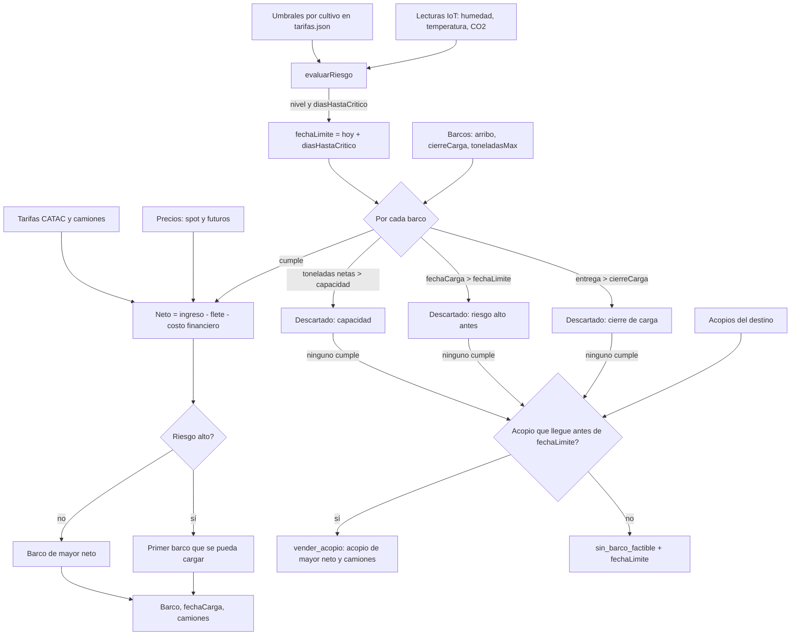
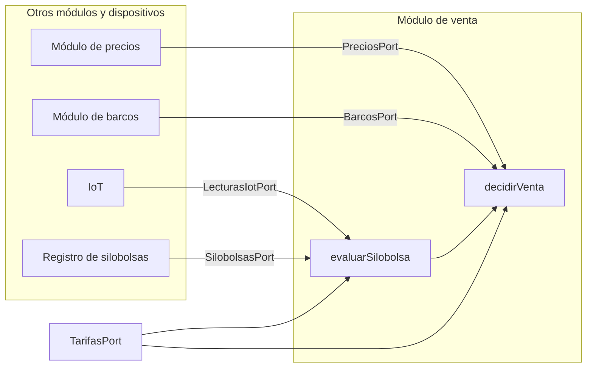

# Venta del silobolsa: cuándo embarcar y qué fletes pedir

Módulo independiente. Recibe silobolsas, lecturas del IoT, precios y barcos por puertos; no sabe de dónde vienen.

> En Argentina el buque lo nomina el exportador: elegir barco aplica a acopios y a grandes productores con venta directa. Para el productor típico, la salida útil es **cuándo sacar la bolsa** y el **acopio o canal** cuando no hay barco a tiempo ([FRENTE.md](FRENTE.md)). Código: `src/domain/silobolsa`, `src/domain/venta`, casos de uso `evaluarSilobolsa` y `decidirVenta`.

## Flujo de la decisión



### Precio de entrega (curva spot + futuros)

El precio de cada barco ya no es "futuro del mes exacto o spot". Sale de la curva (`src/domain/venta/precios.js`):

```
base(hoy)          = spot − futuro de la posición más cercana
precio(fecha)      = F(fecha) + base(fecha)
  F(fecha)  = futuros interpolados entre posiciones (planos fuera de los extremos)
  base(fecha) converge linealmente a 0 al vencimiento de la posición cercana
```

Con spot 300 y diciembre 320, un barco de noviembre cobra entre 300 y 320 (la base −20 se va cerrando), no 300 plano. Cada barco evaluado informa `precioUsdPorT`.

### Vender en acopio si no hay barco a tiempo

Si ningún barco es factible y la entrada trae `acopios` (`entrada.acopios` o `destino.acopios`: `{ nombre, distanciaKm, precioUsdPorT?, descuentoUsdPorT?, tarifaUsdPorT? }`), se evalúa cada acopio:
- **Fechas:** carga apenas hay camiones (hoy + anticipo) y tiene que salir antes de la fecha límite de riesgo.
- **Precio:** el precio esperado del puerto menos el descuento del acopio (8 US$/t por defecto), o el precio que informe el acopio.
- **Costos:** flete CATAC a su distancia, tarifa y secado (6 US$/t por defecto), merma y costo financiero.

Los acopios compiten siempre con los barcos en `evaluados` (`tipo: 'acopio'`); si gana uno, `vender_acopio`. Si ninguna opción llega a tiempo, `sin_barco_factible`.

### Barcos reales y por cultivo

`BarcosPort` está unificado con el módulo de barcos: los adaptadores NABSA (line-up real), manual (CSV) y simulado devuelven `arribo` (ETA + demora típica), `cierreCarga` (ETF de NABSA o arribo + estadía) y `toneladasMax`, además del `cultivo`. `decidirVenta` solo considera los barcos del cultivo de la bolsa. Ver [PLAN_BARCOS.md](PLAN_BARCOS.md).

## Puertos y quién los provee



## Ejemplo (datos de `tests/helpers/silobolsa.js`)

Soja, 200 t, hoy 2026-11-14, puerto a 300 km, spot 300 USD/t, futuro diciembre 320 USD/t, tasa 8 % anual, riesgo bajo.

| Barco | Fecha de carga | t netas | Camiones | Ingreso | Flete | Financiero | Neto | Resultado |
| --- | --- | --- | --- | --- | --- | --- | --- | --- |
| `cierra-antes` | — | — | — | — | — | — | — | Descartado: llegaría después del cierre de carga |
| `barco-noviembre` | 2026-11-24 | 199,93 | 5 | 59.980 | 6.702 | 131 | 53.147 | Factible |
| `barco-diciembre` | 2026-12-19 | 199,77 | 5 | 63.925 | 6.696 | 490 | **56.739** | **Elegido** |

Si la humedad sube (14 → 15 % en 5 días, +0,2 %/día), el nivel alto llega en 5 días (2026-11-19): ningún barco alcanza y la salida es `sin_barco_factible` con esa fecha límite. Con riesgo alto y plazo suficiente se embarca en el primer barco aunque otro pague más.

## Supuestos a validar

| Dato | Valor | Fuente |
| --- | --- | --- |
| Humedad: medio / alto | 14 % / 16 % (girasol 11 % / 14 %) | Guía INTA Balcarce de granos secos en silobolsa |
| Temperatura: medio / alto | 25 °C / 35 °C | **Supuesto**: INTA registró ~40 °C en trigo embolsado en verano |
| CO2: medio / alto | 4 % / 8 % | **Supuesto**: sin fuente abierta con valores concretos |
| Merma por mes: bajo / medio / alto | 0,1 % / 0,5 % / 2 % | **Supuesto**: a ~2 % de pérdida deja de convenir (INTA Balcarce, MPRA) |
| Anticipo de camiones | 7 días | `reserva.anticipo_dias.camion` en `tarifas.json` |
| Descuento y tarifa del acopio | 8 y 6 US$/t | **Supuesto** en `src/domain/venta/supuestos.js`; cada acopio puede informar los suyos |

Todos se editan en `data/tarifas.json` (`silobolsa.por_cultivo.*.umbrales` y `silobolsa.merma_pct_por_mes`).

## Qué cuenta cada opción (barco o acopio)

`neto = ingreso − extracción − flete − costo del acopio − costo financiero`, sobre las toneladas que quedan después de la merma.

| Concepto | Cómo se calcula |
| --- | --- |
| Merma | Fracción de peso perdida hasta el último día de extracción. El ritmo sube de bajo a medio y de medio a alto según los plazos que proyectan las lecturas del IoT (`diasHastaMedio`, `diasHastaCritico`). |
| Extracción | `costo_usd_por_t_extraccion` por tonelada, y días de extractora = toneladas ÷ (`t_por_hora` × horas útiles). Un silobolsa grande tarda varios días y la entrega se corre. |
| Anticipo | Primer día posible de carga = hoy + el mayor anticipo entre camión y extractora (`reserva.anticipo_dias`). |
| Flete | Tarifa CATAC por km del destino (puerto o acopio) con el camión de menor costo por tonelada. |
| Acopio | Precio del acopio y `costoAdicionalUsdPorT`; se vende en la primera fecha de carga. |
| Financiero | Ingreso × tasa anual × días de espera ÷ 365. |

Con riesgo alto se elige lo que se puede cargar primero, que suele ser el acopio. Con riesgo bajo o medio, el mayor neto. El último día de extracción también debe cumplir la fecha límite de seguridad.

## Límites actuales

- El flete usa el camión de menor costo por tonelada (bitrén); no modela estadía ni disponibilidad de camiones.
- Un solo barco por silobolsa: si no entra en `toneladasMax`, se descarta, y la capacidad no se reparte entre bolsas.
- El pedido de la extractora se informa en `elegido.extractora` (desde, hasta, días), pero `armarPedidos` todavía no lo incluye.
- No se modelan almacenaje ni seguro durante la espera.
- El acopio se evalúa en su primera fecha de carga: no hay precio futuro por acopio.
